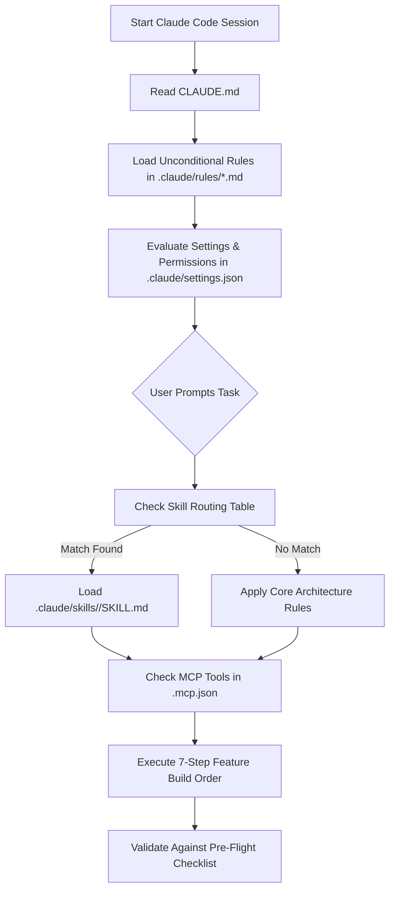

# Anthropic Claude Code Agent Workspace Specification

This document provides the definitive file and directory blueprint for configuring agentic development parameters, modular rules, skills, MCP servers, and security policies for **Claude Code** (Anthropic's official agentic CLI and developer harness).

---

## 📁 Complete Directory Tree

Place this entire structural layout within your project codebase:

```text
your-project-root/
├── CLAUDE.md                        # Master project entry point & orchestration manual
├── AGENTS.md                        # Cross-agent compatibility manifest
├── .mcp.json                        # Project-scoped Model Context Protocol (MCP) servers
├── skills-lock.json                 # Cryptographic hash lockfile for installed skills
├── README.md                        # Workspace specification & architecture documentation
└── .claude/                         # Claude Code project control center
    ├── settings.json                # Project-level permissions, safety boundaries & hooks
    ├── mcp.json                     # Secondary MCP fallback configuration
    │
    ├── rules/                       # Modular project rules (.md files)
    │   ├── 00-overview.md           # Stack, service architecture & 7-step build order
    │   ├── 01-folder-structure.md   # Type-based directory placement
    │   ├── 02-naming-conventions.md # Kebab-case & <name>.<folder>.ts naming
    │   ├── 03-typescript-types.md   # Function declarations & /types single source of truth
    │   ├── 04-validation-zod.md     # Input validation via Zod with .pipe()
    │   ├── 05-service-layer.md      # Pure DB operations only (Drizzle ORM)
    │   ├── 06-action-layer.md       # Auth, validation, orchestration & { data, error }
    │   ├── 07-api-routes.md         # GET-only route handlers delegating to actions
    │   ├── 08-state-management.md   # Zustand client state stores
    │   ├── 09-components.md         # UI primitives vs feature components & leaf client directive
    │   ├── 10-imports-exports.md    # Named exports & @/ path alias
    │   └── 11-error-formatting-env.md # Error shapes, formatting & env type-safety
    │
    ├── skills/                      # Agent Skills packages (Agent Skills open standard)
    │   ├── better-auth-best-practices/ # Better Auth server/client config & plugins
    │   ├── production-auth-architecture/ # End-to-end production auth integration
    │   ├── production-stripe-billing/ # Stripe Checkout, webhooks & subscriptions
    │   ├── codebase-design/         # Deep module boundaries & API design
    │   ├── frontend-design/         # Distinctive visual design & layout guidance
    │   ├── high-end-visual-design/  # Agency-grade polish, animations & typography
    │   ├── postgresql-code-review/  # SQL patterns, indexing & RLS policies
    │   ├── shadcn/                  # shadcn/ui components & registry management
    │   ├── vercel-react-best-practices/ # Vercel performance & React patterns
    │   ├── web-perf/                # Core Web Vitals (LCP/INP/CLS) & speed audits
    │   ├── workers-best-practices/  # Cloudflare Workers anti-patterns
    │   ├── wrangler/                # Cloudflare Wrangler CLI & deployments
    │   ├── caveman/                 # Context-compressed terse communication
    │   ├── caveman-commit/          # Concise conventional commits (<50 chars)
    │   ├── caveman-review/          # 1-line per finding code review
    │   ├── cavecrew/                # Subagent orchestration & delegation
    │   └── git-commit/              # Standard git commit formatting
    │
    └── commands/                    # Custom project slash commands (/project:*)
        ├── commit.md                # /project:commit
        ├── review.md                # /project:review
        └── build-feature.md         # /project:build-feature <feature>
```

---

## 🛠️ File Definitions, Roles, and Specifications

### 1. `CLAUDE.md` (Project Context & Master Orchestration)
* **Purpose:** The primary context file loaded automatically by Claude Code at the start of every session.
* **Role:**
  - Defines the developer persona and target technology stack.
  - Specifies the strict load order: `CLAUDE.md` → `.claude/rules/` → `.claude/skills/` → `.mcp.json`.
  - Maintains the **Skill Routing Table** connecting user tasks to appropriate skill packages.
  - Enforces the **Non-Negotiables Checklist** before tasks are finalized.

### 2. `.claude/rules/*.md` (Modular Project Rules)
* **Purpose:** Break monolithic guidance into modular, maintainable instruction files.
* **Mechanism:**
  - Standard markdown files located in `.claude/rules/`.
  - **Unconditional (Global) Rules:** When `paths:` frontmatter is omitted, the rule automatically loads into context for every session (identical to `alwaysApply: true` in Cursor or `trigger: always_on` in Antigravity).
  - **Path-Scoped Rules:** When `paths:` YAML frontmatter is specified (e.g., `paths: ["src/api/**/*"]`), Claude Code dynamically injects the instructions only when relevant files are read.

### 3. `.claude/skills/<skill-name>/` (Agent Skills Standard)
* **Purpose:** Domain-specific procedural playbooks and workflows conforming to the open Agent Skills standard.
* **Structure:**
  - Required `SKILL.md` file featuring YAML frontmatter (`name`, `description`, `allowed-tools`).
  - Optional progressive disclosure directories: `references/`, `scripts/`, `assets/`, `templates/`.
  - Loaded conditionally by Claude Code on-demand when user tasks match the skill's semantic description.

### 4. `.mcp.json` (Model Context Protocol Configuration)
* **Purpose:** Connects Claude Code to external tools, databases, and APIs using the Model Context Protocol.
* **Standard Location:** Placed directly at the repository root (`./.mcp.json`).
* **Implementation:**
```json
{
  "mcpServers": {
    "chrome-devtools": {
      "command": "npx",
      "args": ["-y", "chrome-devtools-mcp@latest"]
    },
    "shadcn": {
      "command": "npx",
      "args": ["-y", "shadcn@latest", "mcp"]
    },
    "better-auth": {
      "type": "http",
      "url": "https://mcp.better-auth.com/mcp"
    }
  }
}
```

### 5. `.claude/settings.json` (Permissions, Policies & Hooks)
* **Purpose:** Manages team-wide tool permissions and deterministic execution policies.
* **Evaluation Hierarchy:** `deny` (hard block) → `ask` (prompt user) → `allow` (auto-execute).
* **Implementation:**
```json
{
  "permissions": {
    "deny": [
      "Bash(git push --force*)",
      "Bash(rm -rf /*)",
      "Read(./.env*)"
    ],
    "ask": [
      "Bash(git push *)",
      "Bash(npm publish *)"
    ],
    "allow": [
      "Read",
      "Edit",
      "Write",
      "Bash(npm run *)",
      "Bash(git status)",
      "Bash(git commit *)"
    ]
  }
}
```

### 6. `.claude/commands/*.md` (Custom Project Slash Commands)
* **Purpose:** Automates repetitive prompt workflows via project-scoped slash commands.
* **Invocation:** Files named `<name>.md` are invoked inside Claude Code as `/project:<name>`.
* **Dynamic Arguments:** Supports `$ARGUMENTS` interpolation for user-supplied input.

### 7. `skills-lock.json` (Skill Versioning & Security)
* **Purpose:** A lockfile generated by the agent skills package manager (`npx skills`).
* **Role:** Stores SHA-256 integrity hashes (`computedHash`) and source repositories (`sourceType: github`) for every installed skill to ensure supply-chain reproducibility.

---

## ⚡ Execution Flow & Hierarchy



---

## 🔧 Useful Claude Code Commands

| Operation | Command |
| --- | --- |
| Add a project MCP tool | `claude mcp add --scope project <name> -- <command>` |
| List active MCP servers | `claude mcp list` |
| Install a new skill | `npx skills add <repo> --skill <name> -a claude-code` |
| Update installed skills | `npx skills update` |
| Run custom project command | `/project:commit`, `/project:review`, `/project:build-feature` |
| Access interactive settings | `/settings` |
